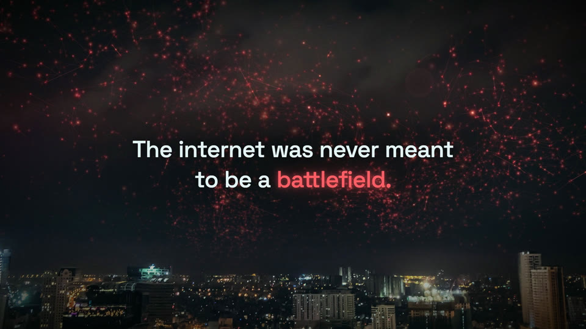
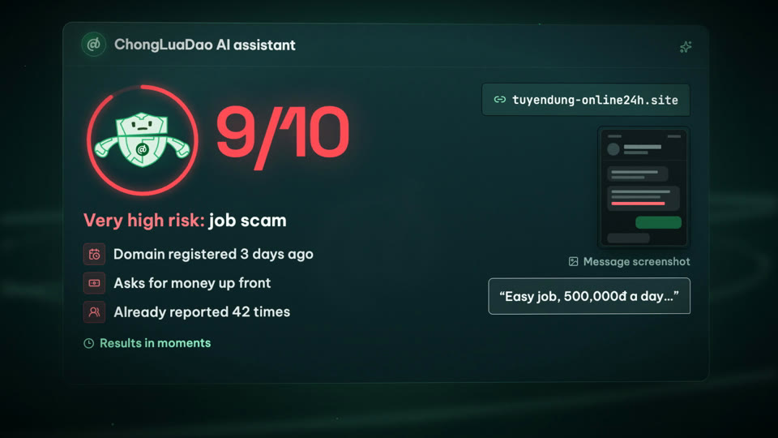
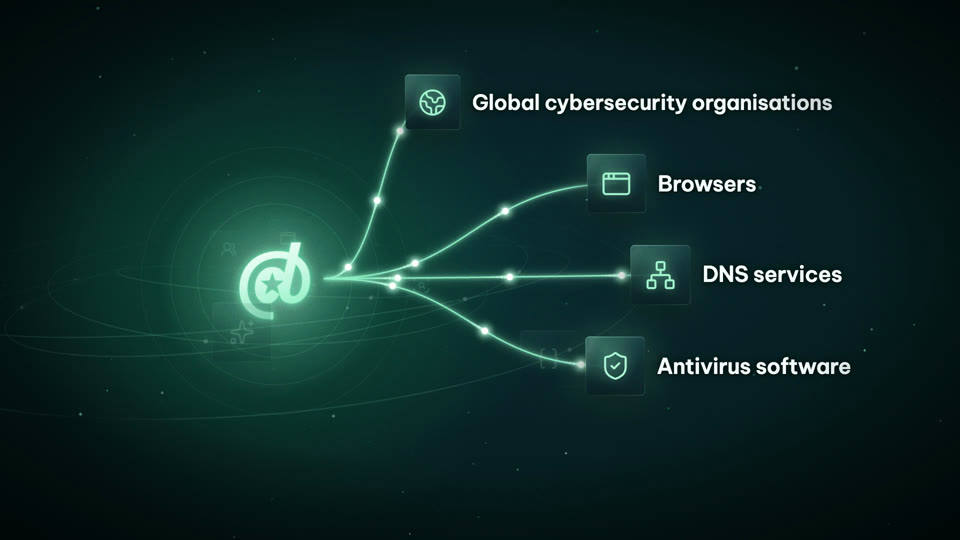
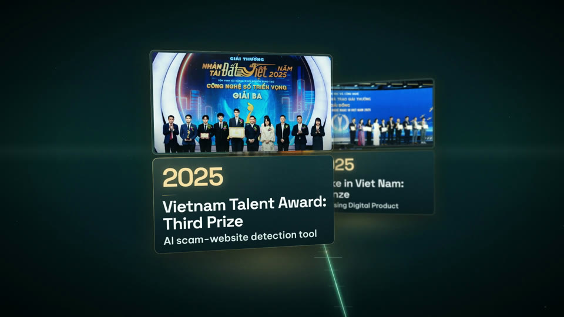
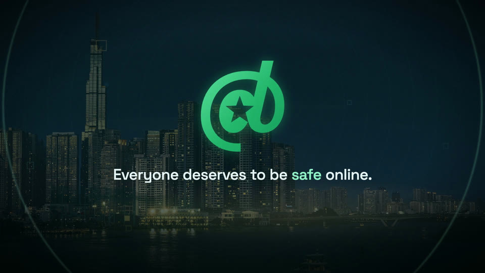

<div align="center">

# Premium Film

**Premium, fact-checked videos that follow your brand guidelines, made with Claude Code.**

Brand films · Product showcases · Event openers · Teasers and promos

[](https://claude.com/claude-code)
[](https://www.remotion.dev)
[](LICENSE)

<a href="https://tadyuh76.github.io/premium-film-demo/"></a>

**[▶ Watch the full example film](https://tadyuh76.github.io/premium-film-demo/)** · 1080p · 60 fps<br>
<sub>A 3½-minute brand film for Chống Lừa Đảo, an anti-scam non-profit (English, captioned), made with the workflow in this skill. It plays in your browser.</sub>

</div>

---

## Why it's different

| | |
|---|---|
| 🎨 **On brand** | Uses your real logo files, colours, fonts and product wording. It never invents a logo or a face. |
| ✨ **Premium in every detail** | Type, motion, 3D, light, voice, music and sound are each designed for your film, not taken from a template. |
| ✅ **Fact-checked** | Every name, number, date and claim is checked against a real source before it goes on screen or into the narration. |

## What it does

You describe the video. Claude then:

1. **Checks your setup** and asks once for any missing AI keys.
2. **Researches** your company or product and writes a fact sheet with sources.
3. **Writes the script** and plans every scene.
4. **Shows you a look sample** before building the whole video.
5. **Builds the scenes** with motion design and 3D.
6. **Records narration**, in any language, and checks every word.
7. **Composes the music** and adds sound effects.
8. **Reviews the result** for glitches, readability and audio problems.
9. **Exports** a video per language, captioned versions, subtitle files, thumbnails and a zip.

Then it handles your feedback ("the transition at 1:12 feels weird") and re-renders only what changed.

## Gallery

<table>
  <tr>
    <td></td>
    <td></td>
    <td></td>
  </tr>
  <tr>
    <td></td>
    <td></td>
    <td></td>
  </tr>
</table>

## Install

You need [Claude Code](https://claude.com/claude-code). We recommend **Claude Opus 5.5**: run `/model` and pick Opus, or start with `claude --model claude-opus-5-5`.

**As a plugin** (recommended, so you get updates):

```
/plugin marketplace add tadyuh76/premium-film-skill
/plugin install premium-film@premium-film-skill
```

**With the skills installer:**

```bash
npx skills add tadyuh76/premium-film-skill
```

**By hand:**

```bash
git clone https://github.com/tadyuh76/premium-film-skill.git
cp -R premium-film-skill/skills/premium-film ~/.claude/skills/
```

### Your computer needs

- **Node.js 22+, ffmpeg and zsh:** `brew install node ffmpeg` on a Mac
- **Docker:** [Docker Desktop](https://www.docker.com/products/docker-desktop/) or [Colima](https://github.com/abiosoft/colima). The audio and caption tools run inside it
- **About 10 GB of free disk,** plus a few GB per export

Tested on macOS with Apple Silicon. Linux should work; Windows is untested.

## Usage

Describe the video you want. The skill starts on its own, or you can type `/premium-film`. The film above started from a request like this:

> Research Chống Lừa Đảo, the anti-scam non-profit, and make a brand film of about 3–4 minutes for a general audience. Tell their story: the technology, the people, the community, their partners, achievements and awards. Make it premium and polished, with rich motion graphics and sound, and use their real photos. Vietnamese and English versions, with captions. I want the best possible result.

Then give feedback in plain words:

> The transition into the team section feels weird and the music drops after the build-up. Fix it.

**How long it takes:** about 45 minutes for a 15-second video and about 2 hours for a 30-second one.

**For the best result:** give it your logo files, brand colours and fonts, and real photos. React to the look sample; that's the easiest moment to change direction.

## AI services (all optional)

| Service | What it adds |
|---|---|
| [OpenRouter](https://openrouter.ai) *(recommended)* | One key for narration, image generation and the AI review |
| [Gemini API](https://aistudio.google.com) | Narration and the AI review. The free tier is enough |
| [ElevenLabs](https://elevenlabs.io) | More narration voices, including your own |
| [Codex CLI](https://github.com/openai/codex) | Image generation with a ChatGPT plan |

With no keys at all, you still get designed on-screen text, music, every check and the export, but no narration or AI review. Keys go in the video project's `.env` file and are never shown. The skill asks before spending money.

## Tech stack

| Part | Tools |
|---|---|
| Video | [Remotion](https://www.remotion.dev), React, TypeScript |
| 3D | [three.js](https://threejs.org), React Three Fiber |
| Narration | Gemini text-to-speech, ElevenLabs |
| Word checks and captions | Whisper (faster-whisper) |
| Music and sound | Python, FluidSynth with General MIDI instruments, Pedalboard |
| Mixing and loudness | FFmpeg, pyloudnorm |
| Photos in depth | Depth Anything V2, LaMa inpainting, Apple Vision on macOS |
| Generated images | GPT Image 2 via OpenRouter, or the Codex CLI |
| AI review | Gemini Flash, which watches and listens to each cut |
| Voice matching | SpeechBrain |
| Research | A headless Chrome browser and the Internet Archive |
| Running it all | Node.js, Docker, FFmpeg |

## What's inside

```
skills/premium-film/
├── SKILL.md       workflow, rules and tool list
├── references/    detailed guides: design, research, narration, music, review, export
├── template/      a starter video project with the audio engine and tools
├── docker/        recipes for the audio and caption containers
└── scripts/       creates a new video project from the template
```

## License

[MIT](LICENSE): free to use, change and share. The example film belongs to Chống Lừa Đảo.
